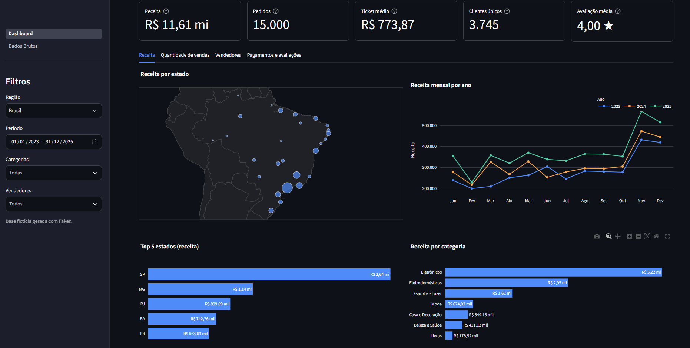
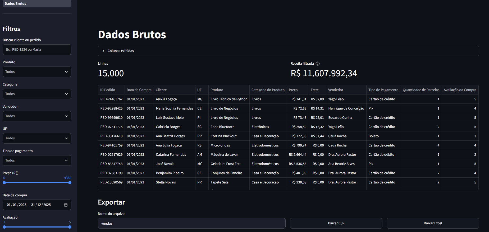

# Dashboard de Vendas em Streamlit

Dashboard interativo de vendas de um e-commerce fictício, feito com Streamlit, Pandas e Plotly. A base de dados é gerada com Faker, então o projeto roda sem depender de API externa nem de dados reais.

**Acesse a aplicação online:** [dashboard-de-vendas-bruno-lima.streamlit.app](https://dashboard-de-vendas-bruno-lima.streamlit.app/)

[](https://dashboard-de-vendas-bruno-lima.streamlit.app/)

## Telas

Página principal com os KPIs, o mapa de receita por estado, a evolução mensal comparando 2023, 2024 e 2025 e os rankings de estados e categorias:



Página Dados Brutos, com busca, filtros na barra lateral e exportação em CSV ou Excel:



## Funcionalidades

### Dashboard (página principal)

- KPIs de receita, pedidos, ticket médio, clientes únicos e avaliação média, com a variação em relação ao período anterior de mesma duração (quando esse período está inteiro dentro da base)
- Receita e ticket médio consideram só o preço dos produtos, sem o frete
- Filtros por região, período, categoria e vendedor
- Abas Receita e Quantidade de vendas: mapa por estado, evolução mensal comparando os anos, top estados e categorias
- Aba Vendedores: ranking configurável e tabela de desempenho
- Aba Pagamentos e avaliações: mix de formas de pagamento, parcelamento, distribuição das notas e top clientes

### Dados Brutos

- Tabela completa com busca por cliente ou pedido, filtros e escolha de colunas
- Exportação do recorte filtrado em CSV (padrão brasileiro: `;` e vírgula decimal) ou Excel

## A base de dados

A base é gerada por [src/gerar_dados.py](src/gerar_dados.py): são 15 mil pedidos entre 2023 e 2025, com:

| Coluna | Descrição |
|---|---|
| ID Pedido, Data da Compra | Identificador e data do pedido |
| Cliente, UF, Região | Cliente (nome único via Faker) e localização |
| Produto, Categoria do Produto | Catálogo de 37 produtos em 7 categorias |
| Preço, Frete | Valores em R$ (frete grátis a partir de R$ 299) |
| Vendedor | 12 vendedores (nomes via Faker) |
| Tipo de Pagamento, Quantidade de Parcelas | Cartão, Pix, boleto; parcelamento só no crédito |
| Avaliação da Compra | Nota de 1 a 5 |
| lat, lon | Coordenadas da capital da UF, usadas no mapa |

Para que os gráficos mostrem padrões, a geração segue algumas regras:
- picos em novembro (Black Friday) e dezembro (Natal), e menos vendas no fim de semana
- crescimento de cerca de 18% no volume a cada ano
- vendas por estado proporcionais ao peso econômico de cada um
- clientes recorrentes em cauda longa: poucos clientes concentram muitas compras

A seed é fixa (`42`), então os números são sempre os mesmos entre execuções e deploys.

> Todos os dados são fictícios. Qualquer semelhança de nomes com pessoas reais é coincidência.

## Como executar

Pré-requisito: Python 3.11 ou superior.

```bash
git clone https://github.com/CesarBrunoM/Dashboard-de-Vendas-Streamlit.git
cd Dashboard-de-Vendas-Streamlit

python -m venv venv
# Windows
venv\Scripts\activate
# Linux / macOS
source venv/bin/activate

pip install -r requirements.txt
streamlit run Dashboard.py
```

O app abre em `http://localhost:8501`. A base é gerada em memória na primeira execução e fica em cache.

### Gerar a base como arquivo (opcional)

```bash
python -m src.gerar_dados --linhas 15000 --seed 42 --saida data/vendas.csv
```

Se `data/vendas.csv` existir, o app usa esse arquivo em vez de gerar a base. Isso permite testar outros volumes ou outras seeds. Quando o arquivo muda, o app recarrega a base na próxima interação. O arquivo fica fora do Git (veja o `.gitignore`).

## Estrutura

```
├── Dashboard.py              # Página principal
├── pages/
│   └── 1_Dados_Brutos.py     # Tabela, filtros e exportação
├── src/
│   ├── gerar_dados.py        # Geração da base com Faker
│   └── utils.py              # Carga com cache e formatação de números
├── data/                     # CSV opcional gerado localmente
├── docs/img/                 # Capturas de tela usadas neste README
├── .streamlit/config.toml    # Tema
├── .devcontainer/            # Ambiente para GitHub Codespaces
├── requirements.txt
└── LICENSE                   # MIT
```

## Deploy

O projeto pode ser publicado no [Streamlit Community Cloud](https://streamlit.io/cloud): conecte o repositório e escolha `Dashboard.py` como arquivo principal. Também roda direto no GitHub Codespaces pelo devcontainer.

## Tecnologias

Python · Streamlit · Pandas · Plotly · Faker · NumPy · XlsxWriter

## Licença

Distribuído sob a licença MIT. Veja o arquivo [LICENSE](LICENSE).
